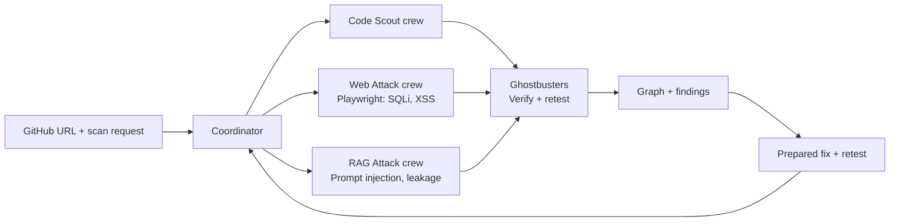

# Kage Crew Architecture (MVP)

## Product shape

Kage Crew is a graph-based security workbench with two distinct targets: a public GitHub repository for read-only source checks, and a hosted, intentionally vulnerable lab for active browser attacks. A bounded coordinator dispatches three ghost crews—Code Scout, Web Attack, and RAG Attack—and a blue-team Ghostbusters crew that verifies evidence and retests fixes. A public repository is never executed, and attack crews target only the Kage Crew lab in the MVP.

## Orchestrated scan

The coordinator creates a bounded workflow graph and dispatches fixed crews:

1. **Code Scout crew** validates and fetches a public GitHub snapshot, inventories supported languages, then runs deterministic secret, dependency, and common source checks. It does not execute repository code. Findings include file/line evidence; secrets are redacted.
2. **Web Attack crew** uses Playwright and safe deterministic checks against the lab's vulnerable SQL and XSS routes.
3. **RAG Attack crew** attacks the lab chat with bounded, response-informed prompt injections. The judge can ingest one Markdown or text document into the lab's real retrieval path to demonstrate poisoning and leakage.
4. **Ghostbusters crew** verifies each reported finding using deterministic proof rules and performs the blue-team retest after a fix. The language model can propose/adapt prompts, but cannot declare its own success.

The code scan and lab attacks may run in parallel. The coordinator tracks status, limits, errors, and dependencies; crews cannot choose arbitrary targets or spawn unbounded agents. Findings flow into one report and graph. Retest dispatches the relevant check again after the judge applies a prepared lab fix.

Each crew has a distinct role, bounded tools, and visible run state. The RAG Attack crew uses the configured LLM for adaptive prompts; Code Scout and Web Attack use deterministic analysis/check packs, and Ghostbusters use deterministic proof rules. This keeps the orchestration multi-agent without making model calls responsible for every security verdict.

## Run flow

1. Judge pastes a public GitHub URL and starts a scan.
2. Code Scout analyzes the repository snapshot; Web Attack and RAG Attack crews test the hosted lab. The UI labels these as separate targets.
3. Crews emit progress and evidence nodes. Ghosts move only along workflow and target relationships observed by the run.
4. Ghostbusters record confirmed, not reproduced, unsupported, or error states. Confirmed findings show source/page, check, observed evidence, and relevant OWASP mapping.
5. Judge applies a prepared fix in the lab and retests. Ghostbusters capture a finding ghost only when the corresponding verifier confirms the issue no longer reproduces; otherwise it remains.
6. ElevenLabs narration may announce progress and findings if configured. Typed controls and visible status remain available without voice.

## Safety and limits

- GitHub input accepts public repositories only, with archive size, file count, and runtime limits. Never execute repository code, install its dependencies, or expose secret values in output.
- Active attacks target only the bundled lab in the public MVP. The submitted repository is not treated as a live app.
- SQLi and XSS checks use non-destructive test cases and synthetic data. RAG documents and canaries are isolated to the lab.
- Bound prompt count, response size, runtime, browser navigation, scan concurrency, and model usage.
- Show unsupported languages and unavailable checks explicitly; accepting a repository URL does not claim complete coverage.
- Map prompt injection and confirmed synthetic data disclosure to the relevant OWASP LLM categories. Map conventional findings to applicable OWASP Web Application categories; do not claim full coverage.

## Hosted deployment

Use a version-pinned Docker service on Google Cloud Run for the UI/API, security lab, and Playwright Chromium runtime. Add a health endpoint, one-at-a-time scan control, request and archive limits, and visible errors. Keep a local Docker run path for the same app and lab.

## MVP components

- **Coordinator:** bounded graph workflow that dispatches crews, aggregates events, and starts evidence-backed retests.
- **Repo intake and code checks:** read-only public GitHub snapshot and deterministic secret, dependency, and common source checks.
- **Web Attack crew:** Playwright tests for SQLi and XSS against the fixed lab routes.
- **RAG Attack crew:** one model-backed specialist that performs bounded, adaptive prompt-injection attempts against the lab's retrieval chat.
- **Ghostbusters:** deterministic verification for source matches, harmless browser effects, and canary exposure, followed by retest after a fix.
- **Lab:** deliberately vulnerable web routes plus a RAG chat, isolated synthetic data, one-document Markdown/text ingestion, and prepared remediations.
- **Graph:** coordinator, crews, repository files, lab pages, retrieved chunks, findings, and evidence appear as nodes connected by observed run events.
- **Voice:** optional ElevenLabs TTS; STT and voice commands are deferred.

## Model credentials

Use one developer-configured server-side provider credential stored as a Cloud Run secret. Enforce strict request and token budgets; never expose or log the key. Deterministic source and browser checks remain usable if model access is unavailable. Mark the RAG Attack crew unavailable rather than substituting scripted prompts and claiming autonomy.

## Deferred

Arbitrary live website attacks, private repository access, execution of submitted code, local development CLI, broad language coverage, unrestricted crawling, multi-tenant accounts, multiple model providers, MCP discovery, automatic source edits, persistent history, and live threat intelligence.
